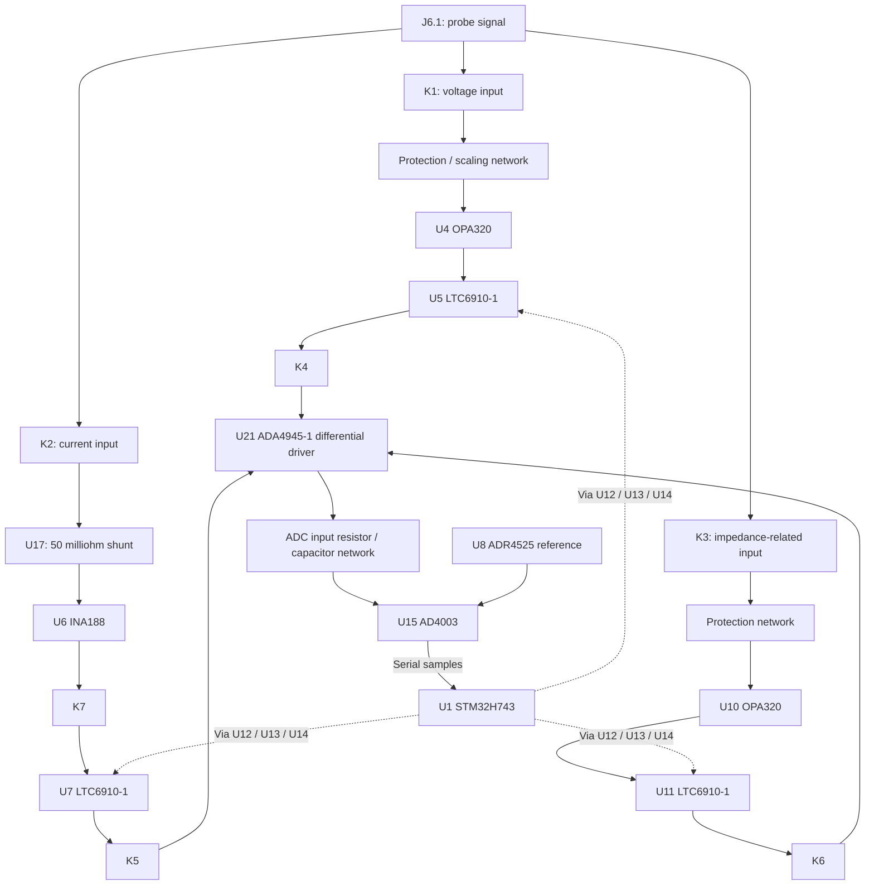

# SPECTER Measurement PCB

A four-layer measurement and acquisition PCB developed for **SPECTER**, a prototype automated PCB diagnostic instrument using robotic probes.

The design combines an **STM32H743 controller, AD4003 ADC, ADA4945-1 differential driver and three programmable-gain measurement channels**.

## Purpose

The board receives signals from the probe system, provides input conditioning and programmable gain, selects a measurement path and digitizes its response. An STM32 controller handles channel control, acquisition timing, processing and communication with the rest of SPECTER.

The complete instrument also includes a separate power/signal-generation subsystem, PC/Raspberry Pi software and robotic probe positioning. Those subsystems are outside this measurement PCB.

## Hardware architecture

| Block | Components | Function |
| --- | --- | --- |
| Controller | U1 STM32H743ZIT6 | Arm Cortex-M7 controller for acquisition and system communication |
| Voltage channel | U4 OPA320, U5 LTC6910-1 | Input buffering and programmable gain |
| Current channel | U17 FC4L16R050FER, U6 INA188, U7 LTC6910-1 | Shunt sensing, instrumentation amplification and programmable gain |
| Impedance-related channel | U10 OPA320, U11 LTC6910-1 | Buffered input and programmable gain for the externally excited measurement path |
| Input switching | K1, K2, K3 | Relay selection of voltage, current and impedance-related input paths |
| Output switching | K4, K5, K6 | Relay selection of the PGA output sent to the shared ADC driver |
| Current-path connection | K7 | Connects the INA188 output to the current PGA input |
| Relay drivers | U2, U3 ULN2003A | Drive relay coils from control signals |
| PGA control buffers | U12, U13, U14 SN74AHCT125 | Buffer STM32 gain-control signals into the 5 V logic domain |
| Differential ADC driver | U21 ADA4945-1 | Drives the ADC's differential inputs |
| ADC | U15 AD4003BRMZ | 18-bit differential SAR conversion |
| Reference | U8 ADR4525BRZ | Nominal 2.5 V precision reference |
| Reference-related buffers | U9, U18 OPA320 | ADC-driver common-mode and INA188 reference circuitry |
| Input supply protection | U27 MAX17608 | Protected supply entry |
| Supply conversion | PS1 TPS62163, U22 TPS62162, U20 TPS7A2018 | 5 V, 3.3 V and 1.8 V supplies |
| Buck inductors | L2 XGL5030-222MEC, L1 XGL4020-222MEC | Inductors for the 5 V and 3.3 V converters |

The AD4003 device supports up to 2 MSPS according to its datasheet. That device rating is **not a demonstrated sampling rate for this complete board**; firmware timing, interface configuration and analog settling must also be established.

## Measurement flow



Each measurement path has its own conditioning and programmable-gain stage, but the differential driver and ADC are **shared**. K4-K6 select which PGA output reaches the driver. Relays provide channel selection between the programmable-gain stages and the shared ADC driver.

Separate front ends do not provide simultaneous digitization. Firmware must coordinate relay states, gain changes, settling and conversion timing. The current-path relay K7 is driven through a U3 channel whose input is connected to the 5 V power-good net in this saved revision.

## Power tree

```text
J4: external 12 V input
  |
  +-- U27 input protection --> protected +12V
                                |
                                +-- PS1 + L2 --> 5 V
                                |
                                +-- U22 + L1 --> 3.3 V --> U20 --> 1.8 V
```

The protected 12 V rail also supplies the INA188. The 5 V rail supplies the PGAs, analog driver, buffers and relay circuitry. The STM32 and ADC digital interface use 3.3 V; the AD4003 analog supply uses 1.8 V.

The 3.3 V converter is supplied from the protected input independently of the 5 V converter. USB VBUS is connected to detection circuitry rather than the board's operating 5 V rail.

## Connectors

Use KiCad pad numbers to establish orientation, rather than assuming left and right from a photograph.

| Connector | Purpose | Saved pin assignments |
| --- | --- | --- |
| J1 | ST-LINK / SWD | 1: 3.3 V reference; 2: SWDIO; 3: GND; 4: SWCLK; 5: NRST; 6: GND |
| J2 | ESP32 UART link | 1: STM32 TX; 2: STM32 RX |
| J3 | Raspberry Pi UART link | 1: STM32 TX; 2: STM32 RX |
| J4 | 12 V input from the power subsystem | 1: GND; 2: positive input |
| J6 | Probe connection | 1: `o/p_probe`; 2: `return_probe` |
| J7 | Current/probe-side connection | 1: `crnt_to_probe`; 2: `crnt_return` |
| J8 | USB-C communication | USB D-/D+ to the STM32, with VBUS detection |

J2 and J3 are two-wire signal connectors, not ESP32 or Raspberry Pi power outputs. Cross TX to RX and provide the required common-ground connection separately.

In the saved PCB, `return_probe` and `crnt_return` each connect only to their respective connector pad; they are not internally tied to GND. The complete external return wiring must therefore be defined and checked before using the measurement paths.

## Measurement modes

- **DC voltage and current:** evaluate continuity and resistive faults by comparing a controlled excitation with the measured response. Depending on the test connection, the response can indicate a short, an open circuit or increased path resistance.
- **AC response:** evaluate frequency-dependent impedance using excitation from the signal-generation subsystem.
- **Fault classification:** compare readings with the expected response of the selected fault-PCB path. A single reading does not uniquely distinguish a board fault from poor probe contact or an incorrect test connection.

Resistance calculations use the measured voltage and current (`R = V / I`), with probe/contact effects accounted for. Impedance calculations additionally require the excitation frequency and the relevant amplitude/phase information. These are firmware and calibration tasks, not automatic functions of the PCB alone.

## Firmware responsibilities

- Configure the MCU clocks, communication interfaces and ADC conversion timing.
- Control input and output relays with appropriate mode sequencing.
- Set each LTC6910 programmable-gain code through the AHCT buffers.
- Allow the complete analog chain to settle after switching or gain changes.
- Read ADC samples and apply calibration and measurement processing.
- Exchange commands and results through the selected UART or USB interface.

SWD through J1 provides a programming and debugging interface. USB operation requires the appropriate application firmware or a supported system-bootloader configuration; the PCB alone does not implement a USB command protocol.

## Prototype status and scope

This repository description documents the hardware architecture. It does not establish measured accuracy, successful acquisition at the ADC's maximum rate, immunity to interference or complete fault-detection performance.

The wider SPECTER prototype targets a controlled fault PCB. The intended impedance frequency range is 1 kHz-100 kHz, with a magnitude-accuracy target of +/-2% after calibration. These are system goals, not verified results for this revision.

End-to-end checks must cover the probe returns, input ranges, gain settings, reference levels, ADC-driver behavior, power sequencing and firmware before reporting performance.

## PCB and source files

- Four copper layers.
- STM32H743 / AD4003 / ADA4945-1 architecture.
- Seven relay channels and three LTC6910 programmable-gain stages.
- KiCad project: `SCBiS.kicad_pro`.
- Schematic: `SCBiS.kicad_sch` and the additional schematic sheets supplied with the project.
- Board: `SCBiS.kicad_pcb`.

Keep the project-local footprint and symbol libraries with the source files. The reference for this README is the saved 24 October 2026 routing/DFM revision.

```text
PCB SHA-256: b371d0481f8071126b6a58f23fe88a301be0a6cb624ea9d2b35b959b8cf2d500
```

## Manufacturer documentation

- [STM32H743 — controller datasheet](https://www.st.com/resource/en/datasheet/stm32h743zi.pdf)
- [AD4003 — ADC specifications, pin functions and serial interface](https://www.analog.com/media/en/technical-documentation/data-sheets/AD4003-4007-4011.pdf)
- [ADA4945-1 — fully differential ADC driver](https://www.analog.com/media/en/technical-documentation/data-sheets/ada4945-1.pdf)
- [LTC6910 family — digitally controlled programmable-gain amplifiers](https://www.analog.com/en/products/ltc6910.html)
- [ADR4525 — reference family datasheet](https://www.analog.com/media/en/technical-documentation/data-sheets/ADR4520_4525_4530_4533_4540_4550.pdf)
- [INA188 — instrumentation amplifier datasheet](https://www.ti.com/lit/ds/symlink/ina188.pdf)
- [OPA320 — operational amplifier datasheet](https://www.ti.com/lit/ds/symlink/opa320.pdf)
- [SN74AHCT125 — logic buffer datasheet](https://www.ti.com/lit/ds/symlink/sn74ahct125.pdf)
- [ULN2003A — relay-driver array datasheet](https://www.ti.com/lit/ds/symlink/uln2003a.pdf)
- [TPS6216x — buck converter datasheet](https://www.ti.com/lit/ds/symlink/tps62163.pdf)
- [TPS7A20 — LDO documentation](https://www.ti.com/product/TPS7A20)
- [MAX17608 — input protection datasheet](https://www.analog.com/media/en/technical-documentation/data-sheets/MAX17608-MAX17610.pdf)
